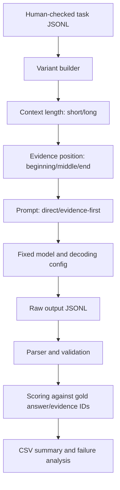

# Prompt 07 — Frozen experiment blueprint (preliminary pilot)

**Status:** Protocol template frozen for planning; checkpoint and task count remain pending environment verification. No results have been viewed or generated.

## Question
How do context length and supporting-evidence position affect answer correctness and evidence selection, and what changes when evidence is identified before answering?

## Design
- Conditions: `direct`, `evidence_first`.
- Context: `short`, `long`.
- Evidence position: `beginning`, `middle`, `end`.
- Matched task variants keep question, gold answer and required evidence IDs unchanged.
- Initial pilot: 20 manually checked tasks; expand only if runtime permits. This is a feasibility choice, not a power calculation.
- Start with one run per condition for debugging; decide on repetitions only after baseline validation and log the decision before comparing results.
- Freeze the checkpoint after Colab diagnostics; do not silently substitute models.

## Architecture

## Metrics
- Primary: answer correctness (higher is better).
- Secondary: supporting-evidence exact-set accuracy/precision/recall (higher), invalid-output rate (lower), input tokens (lower is more efficient), latency (lower is faster).
- Define answer normalization before scoring; no statistical-significance claim unless design and assumptions justify it.

## Controls and reproducibility
Same checkpoint/tokenizer, matched question/source content, same output format, generation parameters and scoring; save raw outputs before parsing; record package versions, seeds and limitations of GPU nondeterminism.

## Deeper analysis
Failure analysis by length and position: wrong answers, missing gold IDs, distractor-driven responses, parsing failures, token usage and latency.

## Threats
Synthetic-task simplicity, one-model generalizability, prompt sensitivity, stochastic generation, metric validity, annotation errors and small pilot size.

## Pre-experiment checklist
- [ ] Verify primary-paper protocols and overlap.
- [ ] Pass Colab environment test; save genuine output.
- [ ] Freeze checkpoint, tokenizer and generation settings.
- [ ] Verify variants preserve gold evidence and answer.
- [ ] Test scoring on hand-checked examples.
- [ ] Save protocol before held-out evaluation.
- [ ] Log protocol deviations before interpreting results.
